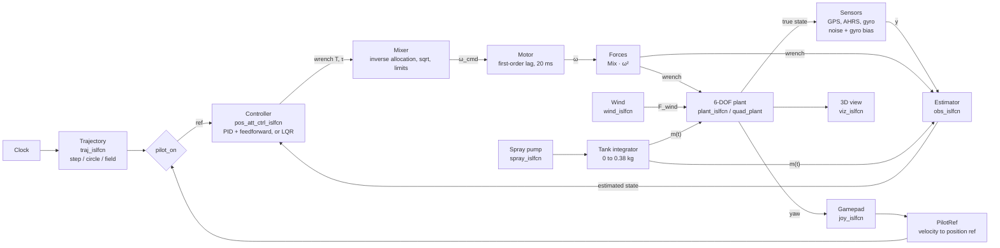
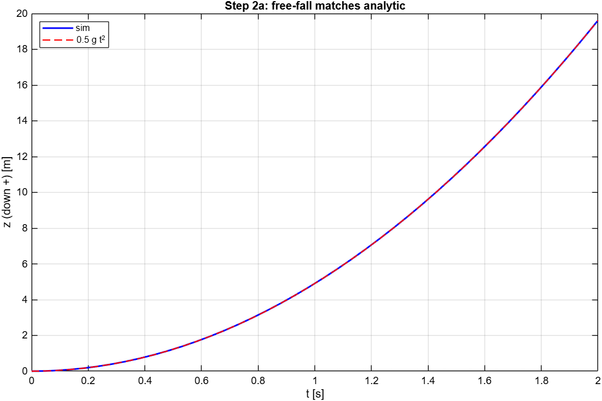
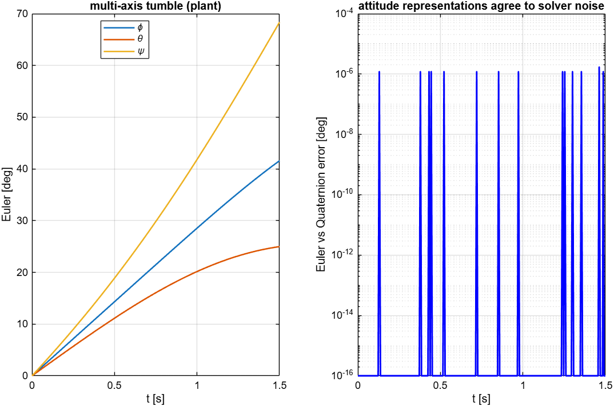
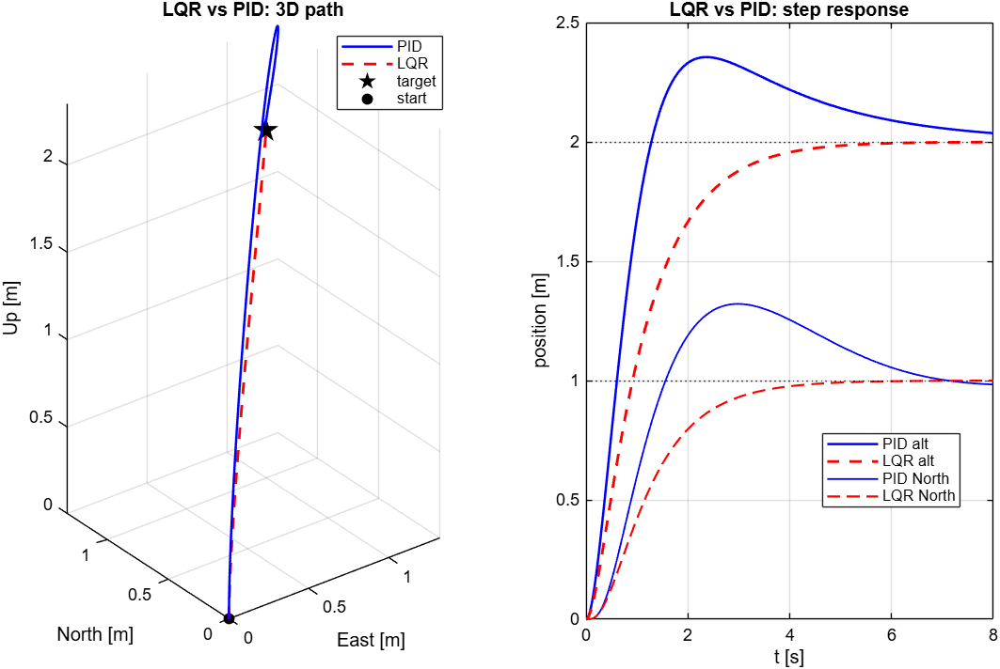
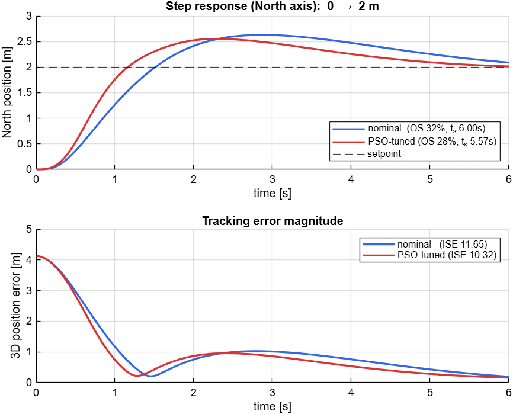
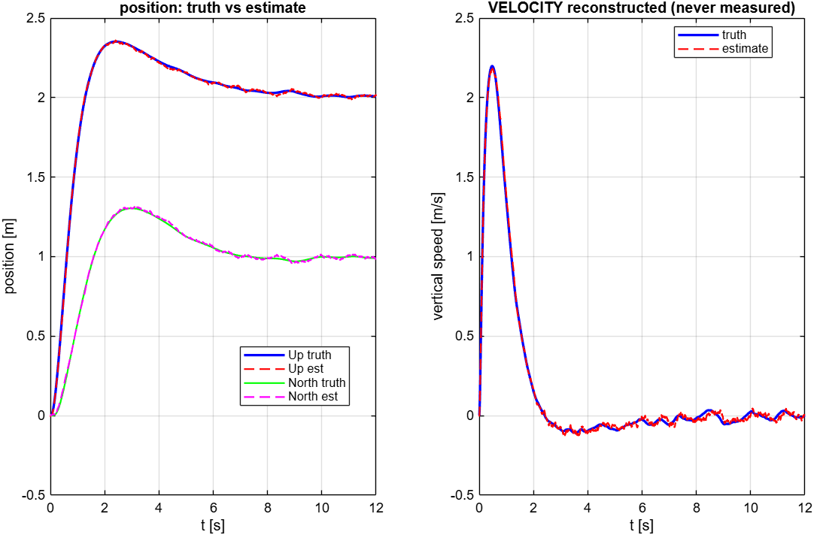
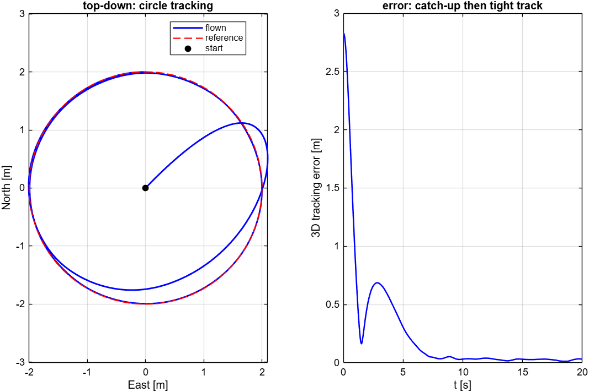
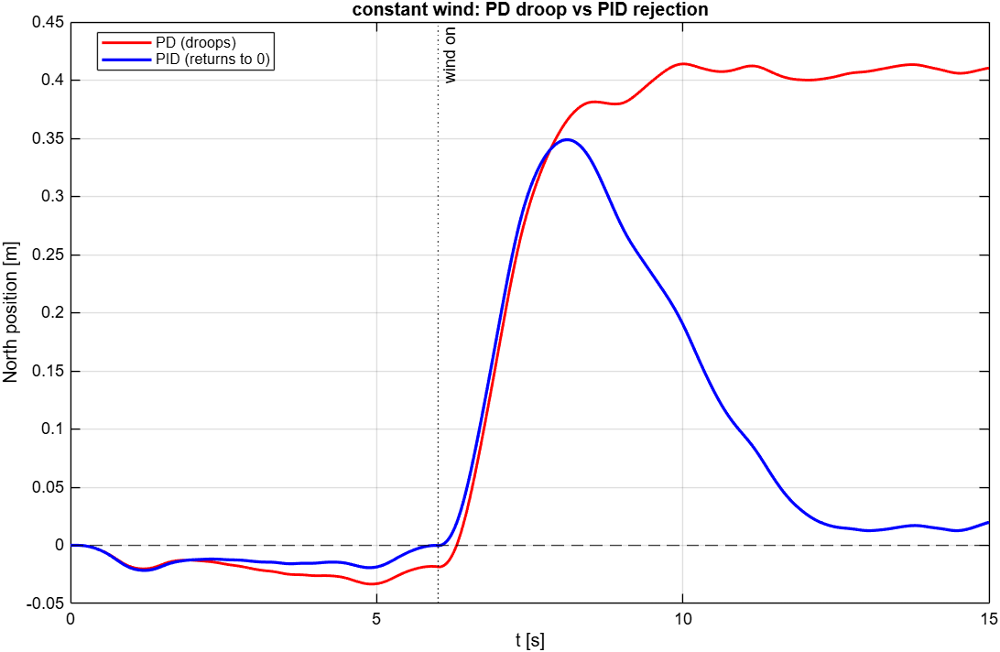
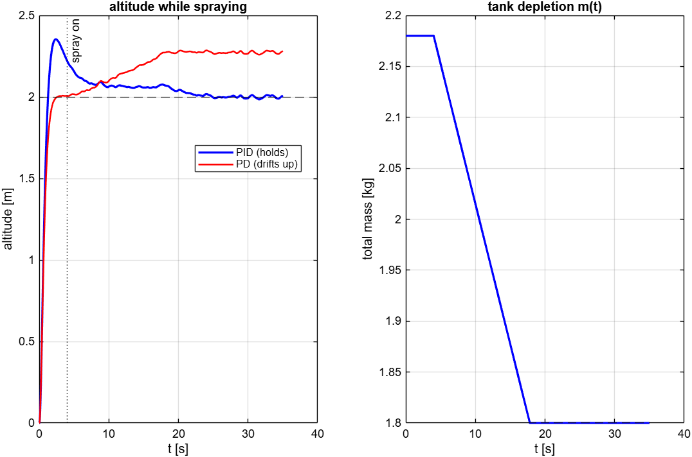

# drone_sim


A closed-loop quadrotor flight simulator in MATLAB and Simulink, built from first principles: 6-DOF rigid-body plant, cascaded PID and LQR control, motor dynamics, noisy sensors, a model-aided state estimator, wind, and a spray tank that makes the aircraft lighter in flight. Every block is checked against an analytic answer or an independent method before the next one is added.


<!-- DEMO: screen recording of the simulator (Win+Alt+R), no room in view -->

## At a glance

| | |
|---|---|
| **Plant** | 6-DOF rigid body, NED world / FRD body frames, ZYX Euler attitude, quadratic drag, time-varying mass (spray tank 2.18 → 1.80 kg) |
| **States** | 12: position and velocity (world), roll/pitch/yaw, body rates |
| **Actuation** | Quad-X, 4 rotors, first-order motor lag (τ = 20 ms), rotor speed limit 970 rad/s |
| **Control** | Cascaded PID with velocity/acceleration feedforward, gains by pole placement; full-state LQR (Bryson weights), switchable while the simulation runs; PID gains auto-tuned with hand-written PSO and GA |
| **Estimation** | Continuous observer: GPS + thrust model for position and velocity (velocity is never measured), gyro + AHRS complementary filter for attitude |
| **Inputs** | Step, circle or lawnmower field path; PS4 gamepad (manual flight); wind force; spray pump |
| **Outputs** | Logged true and estimated states, live 3D view with battery and tank gauges, spray coverage map |
| **Validation** | 16 automated tests (`run_all`), all passing in R2026b |
| **Solver** | Fixed-step ode4, 2 ms (500 Hz) |

## Architecture

The model is `drone_plant.slx`. The nonlinear blocks are Interpreted MATLAB Function blocks that call the same `.m` files the unit tests use, so the Simulink model and the tested code cannot drift apart. The controller flies on the estimated state, never on the true state.



| Block | Implementation |
|---|---|
| Controller | `pos_att_ctrl_islfcn.m` (cascaded PID, integral of the estimated position error with ±3 clamp); hands over to `lqr_ctrl_islfcn.m` when `P.ctrl.mode = 'lqr'` |
| Mixer, Motor, Forces | native blocks: `P.Mix_inv` gain, saturation, sqrt; integrator lag; square + `P.Mix` gain |
| Plant | `plant_islfcn.m` → `quad_plant.m`: `m·v̇ = m·g + R·[0;0;−T] + F_wind + F_drag`, `J·ω̇ = τ − ω×(J·ω)`, `η̇ = W(φ,θ)·ω` |
| Sensors | native: true state + Gaussian noise (GPS 8 cm, AHRS 0.5°, gyro 0.01 rad/s) + constant gyro bias |
| Estimator | `obs_islfcn.m`: `dx̂/dt = f(x̂, u, m) + L·(y − h(x̂))`, mass-aware |
| Parameters | `model_params.m`, run automatically by the model's `PreLoadFcn` |


## Validation

Each layer is tested in isolation against a closed-form answer or a second, unrelated method before the next layer is added. Each test ends in `assert`, so the suite fails if a later change breaks earlier physics. Results below are from R2026b.

| Test | What it checks | Result |
|---|---|---|
| `test_2a` | Free fall vs ½·g·t² (drag off); hover trim | max error 3.6e-15 m; v̇ = 0 at T = m·g |
| `test_2b` | Rotational energy invariant with τ = 0 (checks the gyroscopic term); spin-up p = τx/Jx·t | relative drift 4.1e-10; error 2.8e-17 rad/s |
| `test_2c` | W(0,0) = I; pure roll and pure pitch do not leak; gimbal lock | leakage 0; 1/cos θ = 114.6 at θ = 89.5° |
| `test_2d` | Euler attitude vs an independent quaternion integrator, multi-axis tumble | max difference 1.7e-6° |
| `test_3` | Simulink plant bridge vs `.m` oracle, 2000 random states | identical (difference 0) |
| `test_4` | Attitude loop vs its 2nd-order design, 10° roll step | overshoot 1.51 % (design 1.52 %), rise 0.290 s (design 0.308 s) |
| `test_5` | Fly to (1, 1, −2) m in Simulink | final error 1.3 cm |
| `test_6` | Mixer → forces round trip, 1000 wrenches; hover allocation | 7.2e-15; 4 × 517.0 rad/s |
| `test_7` | Same flight with motor lag | final error 1.3 cm |
| `test_8` | Sensor noise and bias vs spec | GPS σ 0.080 m (spec 0.080), AHRS σ 0.505° (0.500), gyro σ 0.0098 rad/s (0.0100), bias within 0.01°/s |
| `test_9` | Flight on the estimated state | position estimate RMS 1.4 cm, velocity estimate RMS 3.3 cm/s |
| `test_10` | Circle, R = 2 m, T = 10 s, on the estimated state | RMS 3D error 7.2 cm after t = 5 s |
| `test_12` | 2 N gust for 2 s | peak 0.67 m, back to 0.8 cm |
| `test_13` | 1 N steady wind, PD vs PID | droop: PD 0.41 m, PID 0.016 m |
| `test_14` | Hover at 2 m while the tank drains 2.18 → 1.80 kg | PID 1.999 m, PD 2.272 m |
| `test_15` | LQR drop-in vs PID, step to (1, 1, −2) m | LQR final error 0.9 mm |
| `test_16` | Motor current and battery vs hand calculation (not in `run_all`) | 9.24 A per motor at hover, 6.5 min to 20 % reserve |

<p>


</p>

## Results

### PID vs LQR

Step from rest to (1, 1, −2) m, true-state feedback, RK4 at 2 ms (the `test_15` loop).

| | Cascaded PID | LQR |
|---|---|---|
| Settling to 5 cm | 7.33 s | 4.09 s |
| Overshoot, North / altitude | 32.1 % / 17.8 % | 0 % / 0 % |
| Peak tilt | 14.4° | 11.0° |
| Error at t = 8 s | 4.3 cm | 0.9 mm |



The PID overshoot comes from the integral term: on the `sim_step` manoeuvre, North overshoot is 31.5 % with the integral and 0.0 % without it. The LQR has no integral term, so it does not reject a steady disturbance; the PID keeps it for wind and mass change (see below).

### PID auto-tuning: PSO and GA

Both optimisers tune five gains (horizontal position P/I/D, roll/pitch P/D) against the same cost in `ctrl_cost.m`: position ISE + torque effort + control rate + overshoot + steady-state error, for a step from rest to (2, 2, −3) m. Both are hand-written; no Optimization Toolbox. Run with `rng(0)`.

| | Cost J | North overshoot | 2 % settling | ISE |
|---|---|---|---|---|
| Pole-placement gains | 37.34 | 31.5 % | not settled in 6 s | 11.65 |
| PSO (20 particles, 30 iterations) | 32.82 (−12 %) | 27.7 % | 5.57 s | 10.32 |
| GA (population 20, 24 generations) | 32.76 (−12 %) | 27.5 % | 5.63 s | 10.33 |



PSO and GA reach almost the same cost from different searches. Both push the attitude gain to the upper bound of the search band (Kp_att = 110), so a wider band may give a lower cost. The improvement over the pole-placement gains is modest: 12 % in cost, 11 % in ISE.

### State estimation

The controller flies on the observer output. Velocity is never measured; the observer reconstructs it from the thrust model and GPS.

<p>


</p>

### Disturbances: wind and spray

Under a 1 N steady wind the PD controller settles 0.41 m off; the PID returns to 1.6 cm. While the tank drains (−17 % mass), the PD controller climbs to 2.272 m and the PID holds 1.999 m.

<p>


</p>

## Background

I built this simulator on my own in 2026, to design and test the controllers of a spraying quadcopter before flying real hardware. The plant, controllers, estimator, tests, PSO/GA tuning, control panel and 3D view are all in this repository. The `bench/` tools, which run the same scenarios against my own flight-controller firmware, were added later.

## How to run

**Requirements:** MATLAB and Simulink R2026a or newer (the model is saved in R2026a; tested in R2026b), Control System Toolbox (`lqr` in `model_params.m`). Optional: Simulink 3D Animation for the gamepad (`vrjoystick`). PSO and GA are hand-written and need no extra toolbox.

```matlab
cd drone_sim
open_system('drone_plant')     % PreLoadFcn runs model_params
run_all                        % 16 tests + pass/fail summary, a few minutes
```

Single scenarios, after the model is open:

```matlab
test_9_estimator               % setpoint flight on the estimated state
test_10_trajectory             % circle tracking
test_14_spray                  % altitude hold while the tank drains, PID vs PD
rng(0); pso_tune_pid(true); compare_pid   % tune, then nominal vs tuned step
drone_panel                    % interactive: missions, PID/LQR switch, live gains, PSO/GA
```

- Open the model before running a single Simulink test. If the test itself loads the model, `PreLoadFcn` re-runs `model_params` and overwrites the test's settings (`test_10` and `test_14` then fail).
- Interpreted blocks read `P` from the base workspace. After editing `model_params.m`, run it again.
- For real-time interactive flight, enable Run ▸ Simulation Pacing, rate 1.0. Manual flight needs `P.pilot.on = 1`, the 3D view needs `P.viz.on = 1`.

## Limitations and next steps

- **Fault toggles do not reach the Simulink model.** GPS dropout and motor degradation are implemented in `sensors_islfcn.m` and `forces_islfcn.m`, but the model uses the native Sensors and Forces blocks. Checked: with M1 at 60 % the logged states are identical to the healthy run, and the GPS keeps updating during a "dropout". The flags work only in the `.m` loops. Next: move the fault logic into the native blocks.
- **Battery model not wired.** `batt_islfcn.m` and `test_16` exist, but the model does not integrate pack current. The battery gauge in the 3D view uses its own estimate.
- **PID overshoot on large steps** from integral windup (see above). Next: conditional integration or a smaller clamp.
- **PD droop is twice the textbook value.** `test_13` prints F/(m·Kp) = 0.20 m; the measured droop is 0.41 m. The observer's acceleration model does not include the wind, so it carries a velocity bias that the D term acts on.
- **Parameters are derived, not measured.** kf, km, inertia and drag come from datasheets and point-mass estimates. The model has not been compared with flight logs of the real aircraft.
- **Euler attitude** is singular at ±90° pitch. The tilt clamp (30°) keeps the envelope far from it; a quaternion plant would remove it.
- **Interpreted MATLAB Function blocks** are slow, read parameters from the base workspace and are not code-generation ready. The model also still contains disconnected blocks from earlier versions (native controller, function versions of mixer, forces and sensors).
- **Tuning** uses one step manoeuvre with true-state feedback, and the result sits at the edge of the search band.

## Repository layout

| Path | Contents |
|---|---|
| `drone_plant.slx` | Simulink model |
| `model_params.m` | all parameters, derived gains, LQR design, conventions |
| `quad_plant.m` | 6-DOF dynamics (the oracle used by tests and the model) |
| `*_islfcn.m` | functions behind the Interpreted MATLAB Function blocks |
| `test_*.m`, `run_all.m` | validation suite |
| `ctrl_cost.m`, `pso_tune_pid.m`, `ga_tune_pid.m`, `compare_pid.m`, `sim_step.m` | PID auto-tuning and comparison |
| `drone_panel.m`, `fault_panel.m`, `robustness_demos.m` | interactive control panel and scenarios |
| `make_report_figs.m`, `save_figs.m` | figure generation |
| `bench/` | SIL/HIL tools for the ESP32-S3 flight controller, see [bench/README.md](bench/README.md) |
| `docs/` | design notes and images |

## License

All rights reserved; see `LICENSE`.
