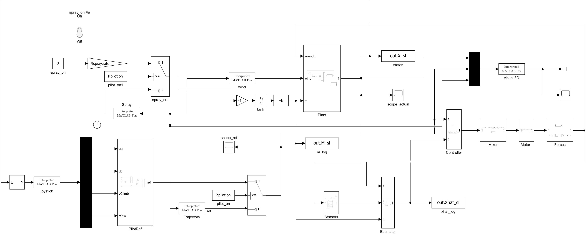
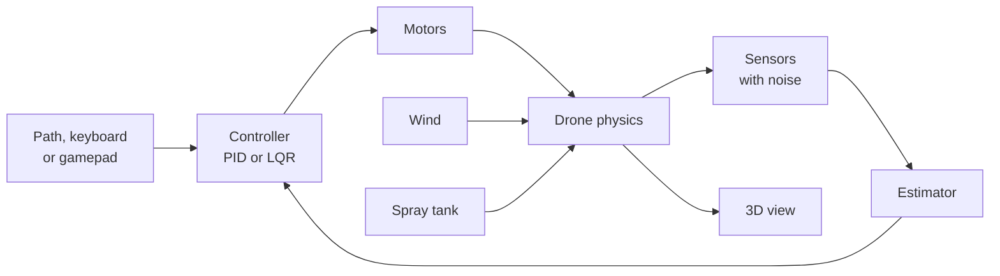
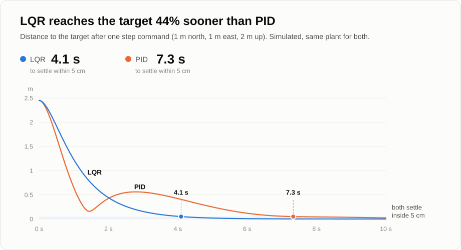

# drone_sim


A quadcopter flight simulator I built in MATLAB and Simulink: the flight physics, two controllers (PID and LQR), noisy sensors and a state estimator. Every part is checked against a known answer before the next one is added.



<!-- DEMO: screen recording of the simulator -->

## Highlights

- **Full flight physics:** 6 degrees of freedom, motor lag, drag, wind, and a spray tank that makes the drone lighter as it empties.
- **Two controllers, switchable in flight:** cascaded PID and LQR. LQR reaches the target 44 % sooner.
- **Auto-tuning:** a hand-written particle swarm and a genetic algorithm tune the PID gains.
- **Flies on estimated data, like a real drone:** the controller only sees noisy GPS, gyro and attitude through an observer. Position error 1.4 cm RMS.
- **16 automated tests:** for example, free fall matches the textbook formula to 3.6e-15 m.
- **Fly it yourself:** keyboard or gamepad control and a live 3D view.

## How it works



## Results

<picture>
  <source media="(prefers-color-scheme: dark)" srcset="docs/img/pid_vs_lqr_dark.svg">
  
</picture>

| | PID | LQR |
|---|---|---|
| Time to settle within 5 cm | 7.3 s | 4.1 s |
| Overshoot | 32 % | 0 % |

- **Wind:** under a steady 1 N push, the PID returns to within 1.6 cm. Without the integral term (PD) it drifts 0.41 m.
- **Spray tank:** while the tank drains and the drone gets 17 % lighter, the PID holds 1.999 m at a 2 m target.

## Run it

Needs MATLAB and Simulink R2026a or newer, with the Control System Toolbox.

```matlab
open_system('drone_plant')   % loads the parameters
run_all                      % the 16 tests, a few minutes
drone_panel                  % control panel: missions, PID/LQR switch, live gains
```

To fly it yourself, press **Manual fly** on the panel, then click the 3D window. Arrows move, W / S go up and down, A / D turn, Space toggles the spray.

## Details

<details>
<summary><b>At a glance</b></summary>

| | |
|---|---|
| Physics | 6-DOF rigid body, quadratic drag, mass changing from 2.18 to 1.80 kg |
| Motors | Quad-X, first-order lag (20 ms), speed limit 970 rad/s |
| Control | Cascaded PID with feedforward (gains by pole placement), full-state LQR |
| Estimation | GPS and thrust model for position and velocity, gyro and AHRS for attitude |
| Inputs | Step, circle or field path; keyboard or gamepad; wind; spray pump |
| Solver | Fixed step, 2 ms |

</details>

<details>
<summary><b>The 16 tests</b></summary>

| Test | Checks | Result |
|---|---|---|
| 2a | Free fall vs ½·g·t² | error 3.6e-15 m |
| 2b | Rotational energy with no torque | drift 4.1e-10 |
| 2c | Attitude kinematics, gimbal lock | as expected |
| 2d | Euler attitude vs a separate quaternion integrator | 1.7e-6° apart |
| 3 | Simulink plant vs the MATLAB model, 2000 random states | identical |
| 4 | Attitude loop vs its design, 10° roll step | overshoot 1.51 % (design 1.52 %) |
| 5, 7 | Fly to a point, with and without motor lag | final error 1.3 cm |
| 6 | Mixer round trip, 1000 cases | 7.2e-15 |
| 8 | Sensor noise vs spec | within spec |
| 9 | Flight on the estimated state | position 1.4 cm RMS, velocity 3.3 cm/s RMS |
| 10 | Circle, 2 m radius | 7.2 cm RMS |
| 12 | 2 N gust for 2 s | back to 0.8 cm |
| 13 | 1 N steady wind, PD vs PID | 0.41 m vs 0.016 m |
| 14 | Hover while the tank drains | PID 1.999 m, PD 2.272 m |
| 15 | LQR vs PID step | LQR final error 0.9 mm |
| 16 | Motor current and battery | 9.24 A per motor at hover |

</details>

<details>
<summary><b>PID auto-tuning</b></summary>

A particle swarm (20 particles, 30 iterations) and a genetic algorithm (population 20, 24 generations) tune five PID gains against the same cost: tracking error, effort, overshoot and steady-state error. Both are hand-written, with no toolbox.

| | Cost | Overshoot | Settling (2 %) |
|---|---|---|---|
| Pole-placement gains | 37.34 | 31.5 % | over 6 s |
| Particle swarm | 32.82 (−12 %) | 27.7 % | 5.57 s |
| Genetic algorithm | 32.76 (−12 %) | 27.5 % | 5.63 s |

</details>

<details>
<summary><b>Limitations</b></summary>

- The GPS-dropout and motor-fault switches only work in the MATLAB loops, not in the Simulink model yet.
- The battery model is written and tested but not connected to the Simulink model.
- Parameters come from datasheets and estimates, not from measurements of the real aircraft.

</details>

<details>
<summary><b>Repository layout</b></summary>

| Path | Contents |
|---|---|
| `drone_plant.slx` | Simulink model |
| `model_params.m` | all parameters and gains |
| `quad_plant.m` | the flight physics |
| `*_islfcn.m` | functions used by the Simulink blocks |
| `test_*.m`, `run_all.m` | tests |
| `pso_tune_pid.m`, `ga_tune_pid.m`, `ctrl_cost.m` | auto-tuning |
| `drone_panel.m`, `drone_keys.m` | control panel, keyboard flying |
| `bench/` | tools that run the same tests against a real flight controller |

</details>

## License

MIT, see [LICENSE](LICENSE).
